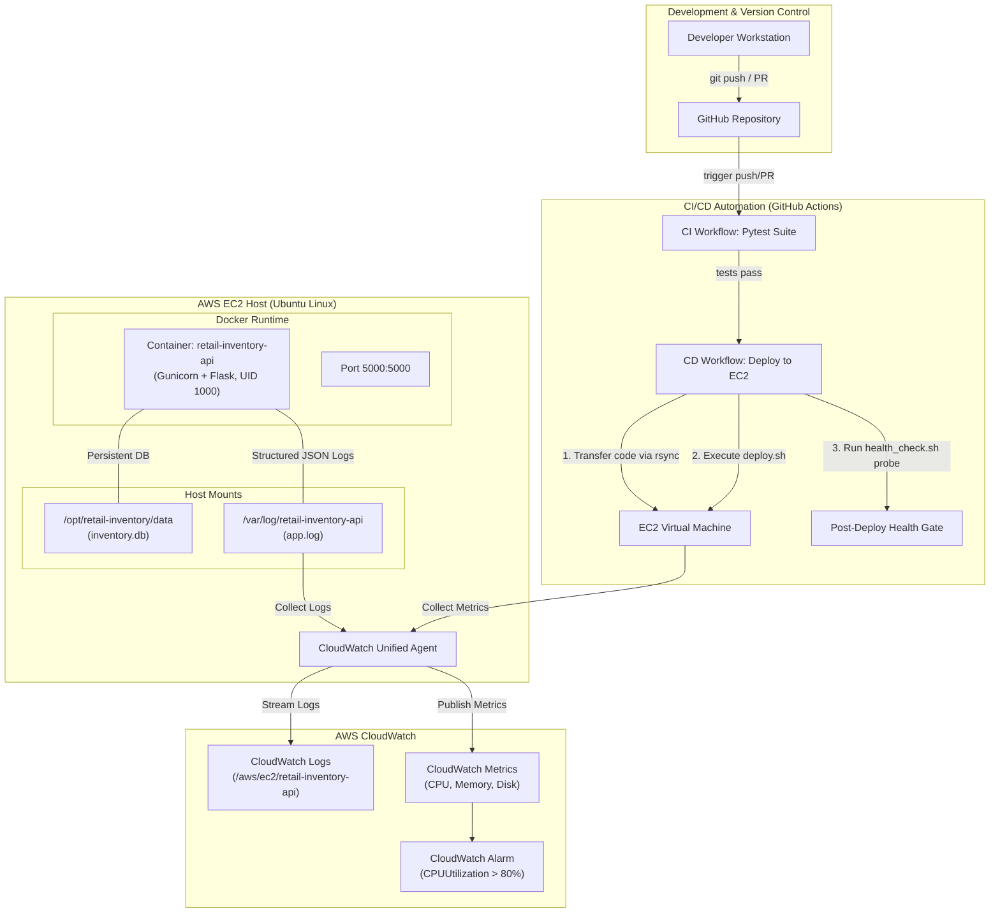

# Retail Inventory API Deployment and Monitoring Pipeline

## 1. Project Overview

The **Retail Inventory API Deployment and Monitoring Pipeline** is a production-style RESTful microservice built with Python and Flask, designed to handle retail inventory cataloging and stock updates. The service persists data using SQLite, runs inside an unprivileged Docker container, and is continuously integrated and deployed to an AWS EC2 instance using GitHub Actions. Operational observability is established via structured JSON logging and the AWS CloudWatch Unified Agent, collecting application logs and host-level system metrics (CPU, memory, and disk).

## 2. Key Features

- **RESTful Inventory Endpoints**: Full CRUD support for products and stock adjustment with strict input validation, consistent status codes, and JSON error structures.
- **SQLite Persistence**: Thread-safe database management leveraging Write-Ahead Logging (WAL) and automated schema initialization.
- **Structured JSON Logging**: Request and error logging with unique correlation IDs (`X-Request-ID`), HTTP methods, paths, latency measurements in milliseconds, and client IP addresses.
- **Hardened Containerization**: Multi-stage/lean Python 3.12 Dockerfile executing as an unprivileged user (`appuser`, UID 1000) with integrated native health check probes.
- **Automated CI/CD Pipeline**: GitHub Actions workflows enforcing automated test suites before automated deployment to AWS EC2 via secure SSH agent authentication.
- **Post-Deployment Health Gates**: Automated HTTP verification probe with retry loops ensuring that zero broken releases remain in production.
- **AWS CloudWatch Ingestion**: Unified CloudWatch Agent configuration streaming application logs to CloudWatch Log Groups and tracking EC2 CPU, memory, and disk utilization.

## 3. Architecture Diagram



## 4. Technology Stack

| Component | Technology | Selection Rationale |
| :--- | :--- | :--- |
| **REST API** | Python 3.12, Flask 3.0.3 | Lightweight, standard WSGI framework with zero bloat |
| **WSGI Server** | Gunicorn 22.0.0 | Production-grade multi-worker Unix WSGI HTTP server |
| **Persistence** | SQLite 3 | Serverless, file-backed database ideal for focused single-node services |
| **Testing** | pytest 8.2.2 | Robust automated testing with isolated fixture management |
| **Containerization** | Docker | Reproducible runtime isolation with non-root security context |
| **Source Control** | Git, GitHub | Distributed version control and PR collaboration |
| **CI/CD** | GitHub Actions | Automated CI test pipelines and SSH-based EC2 deployments |
| **Cloud Hosting** | AWS EC2 (Ubuntu Linux) | Elastic virtual server for hosting Dockerized workloads |
| **Monitoring** | AWS CloudWatch | Unified metrics and centralized structured log aggregation |
| **Scripting** | Linux Bash | Shell scripting for deployment and automated health probing |

## 5. Repository Structure

```text
.
├── .github/
│   └── workflows/
│       ├── ci.yml                     # Continuous integration: runs tests on push & PR
│       └── deploy.yml                 # Continuous deployment: deploys to EC2 and probes health
├── app/
│   ├── __init__.py                    # Flask application factory (create_app)
│   ├── database.py                    # SQLite schema initialization and per-request lifecycle
│   ├── logging_config.py              # Structured JSON logging formatter and handlers
│   ├── models.py                      # Data validation and ProductRepository CRUD DAO
│   └── routes.py                      # REST API routes and global error handlers
├── docker/
│   └── cloudwatch-agent-config.json   # AWS CloudWatch Unified Agent configuration
├── scripts/
│   ├── deploy.sh                      # Production EC2 deployment and container launch script
│   └── health_check.sh                # Automated HTTP curl health verification with retries
├── tests/
│   ├── __init__.py
│   ├── conftest.py                    # Pytest fixtures and temporary database isolation
│   ├── test_health.py                 # Health check and database failure tests
│   └── test_products.py               # Comprehensive product catalog and stock update tests
├── .dockerignore                      # Build context exclusion rules
├── .env.example                       # Documented environment variable definitions
├── .gitignore                         # Excludes databases, venvs, logs, and artifacts
├── Dockerfile                         # Production non-root Python 3.12 container specification
├── README.md                          # Project documentation
└── requirements.txt                   # Minimal pinned dependencies
```

## 6. Prerequisites

### Local Development
- Python 3.12+
- Git 2.40+
- curl (or HTTPie / Postman)
- Docker (optional, for local container testing)

### AWS Infrastructure
- AWS Account with an active EC2 instance running Ubuntu 22.04 or 24.04 LTS.
- Security Group configured with:
  - Inbound SSH (Port 22) restricted to administrator IP / GitHub runner IP.
  - Inbound HTTP (Port 5000) open to client traffic or Application Load Balancer.
- IAM Instance Profile attached to EC2 containing `CloudWatchAgentServerPolicy`.

## 7. Local Setup and Execution

### 1. Clone Repository & Setup Virtual Environment
```bash
git clone https://github.com/harsharaju1314-hash/Retail-Inventory-API-Deployment-and-Monitoring-Pipeline.git
cd Retail-Inventory-API-Deployment-and-Monitoring-Pipeline

# Create and activate virtual environment
python -m venv .venv

# On Linux/macOS:
source .venv/bin/activate
# On Windows (PowerShell):
# .\.venv\Scripts\Activate.ps1
```

### 2. Install Dependencies
```bash
pip install --upgrade pip
pip install -r requirements.txt
```

### 3. Configure Environment Variables
```bash
cp .env.example .env
```
Default `.env` settings:
```ini
FLASK_ENV=development
PORT=5000
DATABASE_PATH=data/inventory.db
LOG_FILE_PATH=logs/app.log
LOG_LEVEL=INFO
```

### 4. Run Application
```bash
python -m app
```
The server will bind to `http://127.0.0.1:5000`.

### 5. Verify Health Endpoint
```bash
curl -i http://localhost:5000/health
```

## 8. API Endpoint Table

| Method | Endpoint | Purpose | Request Body | Success Code | Error Codes |
| :--- | :--- | :--- | :--- | :--- | :--- |
| `GET` | `/health` | Check service and database health | None | `200 OK` | `503 Service Unavailable` |
| `GET` | `/products` | List inventory items (supports `?category=` and `?in_stock=`) | None | `200 OK` | `400 Bad Request` |
| `GET` | `/products/<id>` | Retrieve a single product by numeric ID | None | `200 OK` | `404 Not Found` |
| `POST` | `/products` | Add a new inventory product | JSON (`name`, `sku`, `category`, `price`, `stock_quantity`) | `201 Created` | `400 Bad Request`, `409 Conflict` |
| `PATCH` | `/products/<id>/stock` | Update stock quantity for a product | JSON (`stock_quantity`) | `200 OK` | `400 Bad Request`, `404 Not Found` |

### Sample Requests & Responses

#### Add Product (`POST /products`)
```bash
curl -X POST http://localhost:5000/products \
  -H "Content-Type: application/json" \
  -d '{
    "name": "Barcode Scanner Wireless",
    "sku": "SCAN-WLS-101",
    "category": "Electronics",
    "price": 89.99,
    "stock_quantity": 40
  }'
```
Response (`201 Created`):
```json
{
  "product": {
    "id": 1,
    "name": "Barcode Scanner Wireless",
    "sku": "SCAN-WLS-101",
    "category": "Electronics",
    "price": 89.99,
    "stock_quantity": 40,
    "created_at": "2026-10-16T05:00:00.000000+00:00",
    "updated_at": "2026-10-16T05:00:00.000000+00:00"
  }
}
```

#### Update Stock (`PATCH /products/1/stock`)
```bash
curl -X PATCH http://localhost:5000/products/1/stock \
  -H "Content-Type: application/json" \
  -d '{"stock_quantity": 35}'
```
Response (`200 OK`):
```json
{
  "product": {
    "id": 1,
    "name": "Barcode Scanner Wireless",
    "sku": "SCAN-WLS-101",
    "category": "Electronics",
    "price": 89.99,
    "stock_quantity": 35,
    "created_at": "2026-10-16T05:00:00.000000+00:00",
    "updated_at": "2026-10-16T05:05:00.000000+00:00"
  }
}
```

## 9. Docker Instructions

### 1. Build Docker Image
```bash
docker build -t retail-inventory-api:latest .
```

### 2. Run Container with Host Persistent Mounts
Ensure host directories exist for SQLite data and logs:
```bash
mkdir -p $(pwd)/data $(pwd)/logs
docker run -d \
  --name retail-inventory-api \
  --restart unless-stopped \
  -p 5000:5000 \
  -v $(pwd)/data:/app/data \
  -v $(pwd)/logs:/app/logs \
  retail-inventory-api:latest
```

### 3. Inspect Container Status & Health
```bash
docker ps --filter "name=retail-inventory-api"
docker inspect --format='{{json .State.Health}}' retail-inventory-api
```

### 4. View Structured JSON Logs
```bash
docker logs -f retail-inventory-api
```

### 5. Stop and Clean Up Container
```bash
docker stop retail-inventory-api && docker rm retail-inventory-api
```

## 10. CI/CD Workflow Explanation

The repository includes two GitHub Actions workflows located in `.github/workflows/`:

### Continuous Integration (`ci.yml`)
- **Trigger**: Every `push` and `pull_request` targeting the `main` branch.
- **Actions**:
  1. Checks out the code.
  2. Sets up Python 3.12 with `pip` caching.
  3. Installs dependencies from `requirements.txt`.
  4. Runs `pytest -v`.
- **Purpose**: Prevents regressions or non-compliant changes from being merged.

### Continuous Deployment (`deploy.yml`)
- **Trigger**: Runs on `push` to `main` and on manual trigger (`workflow_dispatch`).
- **Process**:
  1. **Test Gate (`test` job)**: Executes the complete `pytest` suite on the runner. Deployment will not execute if any test fails.
  2. **SSH Connection Setup**: Establishes a secure SSH connection via `webfactory/ssh-agent` using the private key configured in repository secrets.
  3. **Code Synchronization**: Uses `rsync` over SSH to copy the application codebase to `/opt/retail-inventory/` on the EC2 host.
  4. **Host Execution**: Invokes `scripts/deploy.sh` on EC2, which builds the Docker image, cycles the container, mounts persistent volumes, and validates local status.
  5. **Post-Deployment Health Gate**: Executes `scripts/health_check.sh http://${EC2_HOST}:5000/health` from the GitHub Actions runner. If the application does not return HTTP 200 within the retry threshold, the step exits with code 1, marking the deployment workflow as failed.

### Required GitHub Repository Secrets

Configure these under **Settings > Secrets and variables > Actions**:
- `EC2_HOST`: The public IPv4 address or public DNS of the target EC2 instance.
- `EC2_USER`: The SSH username (e.g., `ubuntu`).
- `EC2_SSH_KEY`: The private SSH key (`.pem`) used to authenticate with the EC2 instance.
- `EC2_PORT`: (Optional) The SSH port (defaults to `22`).

## 11. AWS EC2 Deployment and CloudWatch Configuration

### 1. EC2 Instance Preparation
Log into your Ubuntu EC2 instance and install Docker and rsync:
```bash
sudo apt-get update && sudo apt-get install -y docker.io rsync curl
sudo usermod -aG docker ubuntu
newgrp docker

# Create application directories
sudo mkdir -p /opt/retail-inventory /var/log/retail-inventory-api
sudo chown -R ubuntu:ubuntu /opt/retail-inventory /var/log/retail-inventory-api
```

### 2. IAM Role Configuration
1. In the AWS Management Console, navigate to **IAM > Roles > Create Role**.
2. Select **AWS service**, choose **EC2**, and click **Next**.
3. Attach the managed policy: `CloudWatchAgentServerPolicy`.
4. Name the role `EC2-CloudWatchAgent-Role` and save.
5. In the **EC2 Console**, select your instance, go to **Actions > Security > Modify IAM role**, and attach `EC2-CloudWatchAgent-Role`.

### 3. Install and Configure CloudWatch Unified Agent
Download and install the agent Debian package:
```bash
wget https://amazoncloudwatch-agent.s3.amazonaws.com/ubuntu/amd64/latest/amazon-cloudwatch-agent.deb
sudo dpkg -i -E ./amazon-cloudwatch-agent.deb
```
Copy `docker/cloudwatch-agent-config.json` to `/opt/aws/amazon-cloudwatch-agent/etc/amazon-cloudwatch-agent.json`:
```bash
sudo cp /opt/retail-inventory/docker/cloudwatch-agent-config.json \
  /opt/aws/amazon-cloudwatch-agent/etc/amazon-cloudwatch-agent.json
```
Start the CloudWatch Agent with the configuration:
```bash
sudo /opt/aws/amazon-cloudwatch-agent/bin/amazon-cloudwatch-agent-ctl \
  -a fetch-config \
  -m ec2 \
  -s \
  -c file:/opt/aws/amazon-cloudwatch-agent/etc/amazon-cloudwatch-agent.json
```
Verify the agent status:
```bash
sudo /opt/aws/amazon-cloudwatch-agent/bin/amazon-cloudwatch-agent-ctl -m ec2 -a status
```

### 4. CloudWatch Metric & Alarm Setup
To alert the engineering team on resource exhaustion, create a CloudWatch Alarm for CPU utilization:
```bash
aws cloudwatch put-metric-alarm \
  --alarm-name "RetailInventory-High-CPU-Utilization" \
  --metric-name "CPUUtilization" \
  --namespace "AWS/EC2" \
  --statistic "Average" \
  --period 60 \
  --threshold 80.0 \
  --comparison-operator "GreaterThanThreshold" \
  --dimensions Name=InstanceId,Value=<YOUR_INSTANCE_ID> \
  --evaluation-periods 2 \
  --alarm-description "Alert when EC2 CPU exceeds 80% for 2 consecutive minutes."
```

## 12. Testing Instructions

All automated tests are written with `pytest` and execute against an isolated temporary database. No AWS account or live infrastructure is required to run tests.

### Run All Tests
```bash
pytest -v
```

### Run Tests with Short Tracebacks
```bash
pytest -v --tb=short
```

### Test Suite Coverage Breakdown
- `tests/test_health.py`:
  - `test_health_check_healthy`: Verifies HTTP 200 and JSON response schema when SQLite is accessible.
  - `test_health_check_db_failure`: Simulates a database outage and verifies HTTP 503 response.
- `tests/test_products.py`:
  - `test_list_products_initially_empty`: Confirms empty array initialization.
  - `test_create_product_success`: Validates successful product insertion and field sanitization.
  - `test_create_product_missing_fields`: Confirms HTTP 400 when mandatory fields are omitted.
  - `test_create_product_invalid_price`: Confirms HTTP 400 for prices $\le$ 0.
  - `test_create_product_negative_stock`: Confirms HTTP 400 for negative stock numbers.
  - `test_create_product_duplicate_sku`: Confirms HTTP 409 Conflict when inserting an existing SKU.
  - `test_get_product_by_id_success` & `test_get_product_by_id_not_found`: Validates ID resolution and 404 responses.
  - `test_update_stock_success`, `test_update_stock_negative`, `test_update_stock_not_found`: Validates PATCH semantics and bounds checking.
  - `test_list_products_filtering`: Verifies `?category=` and `?in_stock=` query filtering.

## 13. Troubleshooting

### Practical Diagnostic Guide

#### 1. Failed Deployment in GitHub Actions
- **Symptoms**: Step `Transfer Project Files to EC2` or `Execute Deployment Script on EC2` fails.
- **Root Causes**: Incorrect `EC2_HOST`, expired SSH key in `EC2_SSH_KEY`, EC2 Security Group blocking inbound port 22, or `/opt/retail-inventory` lacking write permissions.
- **Diagnostic Steps**:
  1. Test SSH connectivity manually:
     ```bash
     ssh -i <your-key.pem> ubuntu@<EC2_HOST>
     ```
  2. Verify that the user has sudo permissions and belongs to the `docker` group:
     ```bash
     groups ubuntu
     ```
  3. Ensure directory ownership is assigned to the deployment user:
     ```bash
     sudo chown -R ubuntu:ubuntu /opt/retail-inventory
     ```

#### 2. Stopped Container
- **Symptoms**: `docker ps` does not show `retail-inventory-api`.
- **Root Causes**: Gunicorn syntax or configuration error, or exit due to permission issues on the database file.
- **Diagnostic Steps**:
  1. List all stopped containers and check exit codes:
     ```bash
     docker ps -a --filter "name=retail-inventory-api"
     ```
  2. Inspect container runtime logs:
     ```bash
     docker logs --tail 100 retail-inventory-api
     ```
  3. Inspect container termination reason:
     ```bash
     docker inspect retail-inventory-api --format='{{.State.Status}} (ExitCode: {{.State.ExitCode}})'
     ```

#### 3. HTTP 500 Internal Server Error
- **Symptoms**: Client requests return HTTP 500 with message `"An unexpected server error occurred"`.
- **Root Causes**: Unhandled runtime exceptions, SQLite concurrency lock timeouts, or file corruption.
- **Diagnostic Steps**:
  1. Search structured log files on the host for ERROR level entries:
     ```bash
     grep '"level": "ERROR"' /var/log/retail-inventory-api/app.log | jq .
     ```
  2. Query CloudWatch Logs Insights:
     ```sql
     fields @timestamp, request_id, message, error_details
     | filter level = "ERROR"
     | sort @timestamp desc
     | limit 20
     ```

#### 4. Failed Health Check
- **Symptoms**: `scripts/health_check.sh` times out after 12 retries; deployment fails.
- **Root Causes**: Container starting slower than timeout, application binding to `127.0.0.1` instead of `0.0.0.0`, port 5000 not exposed in Docker run command, or database inaccessible.
- **Diagnostic Steps**:
  1. Run health probe locally on EC2:
     ```bash
     curl -v http://localhost:5000/health
     ```
  2. Verify port listening status on the host:
     ```bash
     sudo ss -tulpn | grep 5000
     ```
  3. Test database connectivity directly within the running container:
     ```bash
     docker exec -it retail-inventory-api python -c "from app.database import check_db_connection; print(check_db_connection())"
     ```

---

### Reproducible Failure Scenarios

#### Scenario A: Database Storage Permission Denied (Read-Only Volume)

1. **Reproduction**:
   Change permissions of the host database mount so the container's non-root `appuser` (UID 1000) cannot write to it:
   ```bash
   sudo chmod 400 /opt/retail-inventory/data/inventory.db
   sudo chown root:root /opt/retail-inventory/data/inventory.db
   ```
   Trigger a write operation via the API:
   ```bash
   curl -X POST http://localhost:5000/products \
     -H "Content-Type: application/json" \
     -d '{"name":"Sample Item","sku":"SMP-001","category":"Test","price":10.0,"stock_quantity":5}'
   ```
2. **Observed Failure**:
   The API returns HTTP 500 with a correlation `request_id`.
   Inspection of `/var/log/retail-inventory-api/app.log` reveals:
   ```json
   {
     "timestamp": "2026-10-16T05:10:00.000Z",
     "level": "ERROR",
     "logger": "app",
     "message": "Unhandled server exception: attempt to write a readonly database",
     "error_type": "OperationalError",
     "error_details": "attempt to write a readonly database"
   }
   ```
3. **Resolution**:
   Restore ownership and write permissions to UID 1000:
   ```bash
   sudo chown -R 1000:1000 /opt/retail-inventory/data
   sudo chmod 755 /opt/retail-inventory/data
   sudo chmod 644 /opt/retail-inventory/data/inventory.db
   ```

#### Scenario B: Host Port 5000 Collision

1. **Reproduction**:
   Bind an arbitrary process (such as `netcat` or Python HTTP server) to port 5000 on the host before running the deployment script:
   ```bash
   python3 -m http.server 5000 &
   PID=$!
   ```
   Execute the deployment script:
   ```bash
   ./scripts/deploy.sh
   ```
2. **Observed Failure**:
   The Docker daemon fails to start the container:
   ```text
   docker: Error response from daemon: driver failed programming external connectivity on endpoint retail-inventory-api: Bind for 0.0.0.0:5000 failed: port is already allocated.
   ```
   The script exits with code 1, aborting deployment before routing traffic.
3. **Resolution**:
   Identify the conflicting process binding port 5000 and terminate it:
   ```bash
   sudo ss -tulpn | grep 5000
   # Identify PID and terminate
   sudo kill -9 $PID
   # Re-run deployment
   ./scripts/deploy.sh
   ```

## 14. Security Considerations

- **Non-Root Container User**: The Docker container is strictly executed under unprivileged `appuser` (UID 1000) rather than `root`, limiting blast radius in the event of an application exploit.
- **Zero Hardcoded Secrets**: AWS credentials, private SSH keys, and host IPs are never stored in the repository. Authentication is supplied through GitHub Secrets and IAM roles.
- **Production Error Masking**: Unhandled internal exceptions return generic JSON error messages to clients, withholding database schemas, server file paths, or internal tracebacks. Full stack traces are preserved exclusively in structured server logs.
- **Strict Input Validation**: All numeric and string inputs are bounds-checked and type-asserted before executing SQL queries to prevent malformed queries or unbounded memory allocation.
- **SSH Key Hygiene**: Deployment relies on SSH key authentication managed through ephemeral agent sessions with strict host key checking.
